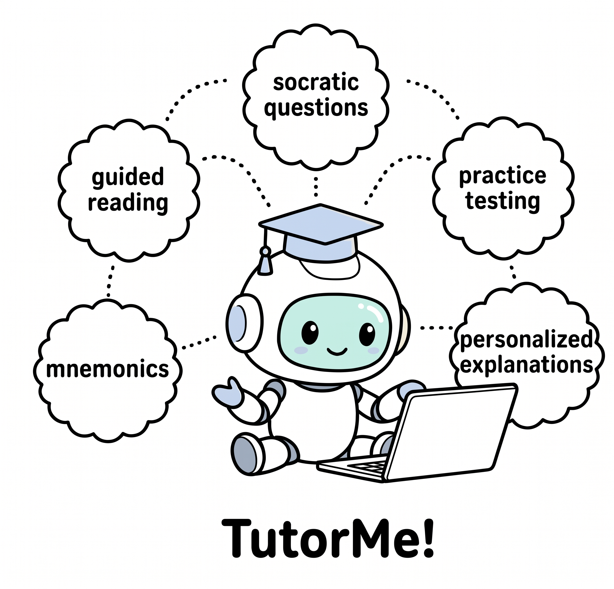

# TutorMe

TutorMe is a collection of AI tutoring strategies based on findings from
education research. In this assignment, you will turn one strategy template
into a clear set of instructions that an AI coding agent can follow.



## Your assignment

You should already have been assigned a tutoring strategy from education to work on by Nishant, Hope, and Zoey. Your job is to:

1. Add class material that you can use for testing.
2. Implement your assigned tutoring strategy.
3. Test the strategy with a coding agent and improve it based on what happens.
4. Add your name to the contributor list

### 1. Set up your repository and coding agent

@Hope add instructions

### 1. Add class materials

Add some class materials to the `/materials` folder, such as lecture notes, a reading, a study guide, or a transcript.

@Zoey add more details and what other examples are

### 2. Implement your assigned strategy

A skill file is a text document that tells an AI agent when and how to perform a specific task. The section at the top gives the skill its name and description, while the rest of the file defines the questions to ask, the workflow to follow, the output to create, and the criteria for success.

The skill files are in:

```text
.agents/skills/<strategy-name>/SKILL.md
.claude/skills/<strategy-name>/SKILL.md
```

Our goal is to create a skill file


| Strategy             | Purpose                                               | Example                                                                                       |
| -------------------- | ----------------------------------------------------- | --------------------------------------------------------------------------------------------- |
| `socratic-questions` | Deepen understanding through follow-up questions.     | “Why do you think increasing temperature changes the reaction rate?”                          |
| `self-explanation`   | Connect new ideas to prior knowledge.                 | “How would you explain electrical current using what you know about flowing water?”           |
| `guided-reading`     | Identify highlights, summaries, and key takeaways.    | “The chapter's central idea is cell division. Let's review its three key stages.”             |
| `practice-testing`   | Create quizzes or flashcards and give feedback.       | “Question 1: During which stage of mitosis do chromosomes line up in the middle of the cell?” |
| `mnemonics`          | Create memorable imagery, keywords, and associations. | “Use HOMES to remember the Great Lakes: Huron, Ontario, Michigan, Erie, and Superior.”        |


Each skill file has a section called **Strategy Workflow** that you need to fill out, showing specific instructions for the agent. For the skill file you have assigned, first understand our strategy:

You can learn more about your strategy by reading [this paper](https://www.whz.de/fileadmin/lehre/hochschuldidaktik/docs/dunloskiimprovingstudentlearning.pdf), or general web search

Then, convert the tutoring strategy into instructions under Strategy Workflow explaining:

- what the agent should do first
- how it should use the selected class materials
- how it should interact with and adapt to the learner
- how it should handle mistakes, uncertainty, and feedback
- how it should decide that the tutoring session was successful

We have a completely filled out example under `mnemonics` that you can follow!

### 3. Test your skill file

To test your skill file, call its name (for example, `/mnemonics`):

- Cursor or Claude Code: `/mnemonics`
- Codex: `$mnemonics`
- Antigravity: ask it to use `/mnemonics`.

Complete at least one full session using the material you added. During the test, confirm that:

- The agent asks what you want to study.
- The session follows the workflow you wrote.
- The agent gives accurate and helpful responses.
- The learning activity in `outputs/` opens and works.

Try at least one unexpected or incomplete answer during the session. If the agent behaves poorly, revise the instructions and run the test again.

## Submission checklist

- [ ] I added at least one test file to `materials/`.
- [ ] I replaced every placeholder in my assigned strategy.
- [ ] The `.agents` and `.claude` copies of my strategy match.
- [ ] I completed a tutoring session using my test material.
- [ ] I opened and tested the generated file in `outputs/`.
- [ ] My strategy passes its success checklist.
- [ ] I added my name below.


## Contributors

- Nishant Balepur
- Dayeon Ki
- Yu Hou

Add your name here!